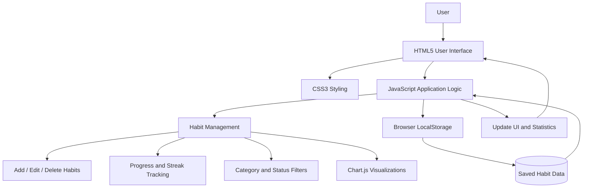

# 🎯 Habit Tracker App

A responsive and interactive **Habit Tracker Web Application** built using HTML, CSS, and JavaScript. This application helps users build positive habits, monitor daily activities, track consistency, and visualize their progress through interactive charts.

The application provides a simple and user-friendly interface to manage daily habits and stay motivated toward achieving personal goals.

## 📌 Project Overview

Building good habits requires consistency and regular progress monitoring. This Habit Tracker application provides a digital platform where users can create habits, define daily targets, track completions, and monitor their performance.

It uses JavaScript for dynamic functionality and browser LocalStorage to save habit information, allowing users to retain their data even after refreshing the page.

## ✨ Key Features

- **Add New Habits:** Create habits with custom names, categories, and daily targets.
- **Edit Habits:** Update existing habit names.
- **Delete Habits:** Remove habits that are no longer required.
- **Habit Categories:** Organize habits into Health, Study, Exercise, and Other categories.
- **Daily Progress Tracking:** Track completed habits against their defined targets.
- **Streak Tracking:** Monitor consecutive days of habit completion.
- **Progress Bar:** Display overall habit completion progress.
- **Category Filtering:** Filter habits based on their categories.
- **Status Filtering:** View completed and pending habits.
- **Dark Mode:** Switch between light and dark themes.
- **Weekly Statistics:** Visualize weekly habit completion using bar charts.
- **Monthly Statistics:** Analyze monthly habit completion across different categories.
- **LocalStorage Integration:** Automatically save habit data in the browser.

## 🛠️ Technology Stack

| Technology | Purpose |
|---|---|
| HTML5 | Structure of the application |
| CSS3 | Styling, layout, and responsive design |
| JavaScript | Dynamic functionality and DOM manipulation |
| Chart.js | Interactive weekly and monthly charts |
| LocalStorage | Persistent storage of habit information |
| Git & GitHub | Version control and project hosting |

## 🏗️ System Architecture

The application follows a **client-side architecture** with three main components: the presentation layer, application logic layer, and browser storage layer.

### Architecture Diagram



### Architecture Components

**1. Presentation Layer – HTML5 & CSS3**
- Provides the user interface.
- Displays habit lists and progress indicators.
- Provides forms and modals for adding habits.
- Supports light and dark themes.

**2. Application Logic Layer – JavaScript**
- Handles habit creation, editing, and deletion.
- Calculates habit completion progress.
- Maintains habit streak information.
- Implements category and status filters.
- Updates weekly and monthly statistics.
- Uses Chart.js to generate visual reports.

**3. Storage Layer – Browser LocalStorage**
- Stores habit information in JSON format.
- Saves completion history and daily targets.
- Retains data between browser sessions.
- Retrieves saved information when the application loads.

## 🔄 Application Workflow

1. The user opens the Habit Tracker application.
2. JavaScript retrieves previously saved habits from LocalStorage.
3. The user creates a new habit by entering its name, category, and daily target.
4. The application updates the habit list dynamically.
5. Users mark habits as completed and monitor their progress.
6. The application updates completion counts and streak information.
7. Users filter habits based on category or completion status.
8. Chart.js displays weekly and monthly habit statistics.
9. Updated habit information is saved automatically in LocalStorage.

## 📂 Project Structure

```text
habit-tracker/
│
├── .vscode/
│
├── index.html       # Application structure
├── style.css        # Styling and responsive design
├── script.js        # Application logic and functionality
│
└── README.md        # Project documentation
```

## ⚙️ Installation and Setup

Follow these steps to run the project locally.

### Prerequisites

- A modern web browser (Chrome, Firefox, Edge).
- Visual Studio Code (recommended).
- Git (optional, for cloning the repository).

### 1. Clone the Repository

```bash
git clone https://github.com/dandeshivraj/habit-tracker.git
```

### 2. Navigate to the Project Directory

```bash
cd habit-tracker
```

### 3. Open the Project

Open the project folder in Visual Studio Code.

### 4. Run the Application

Open `index.html` directly in your browser or use the VS Code Live Server extension.

No backend server or database installation is required.

## 📊 Data Storage and Visualization

**LocalStorage**

The application uses browser LocalStorage to maintain habit records, including:

- Habit name and category.
- Daily completion target.
- Completed count.
- Current streak.
- Last completion date.
- Completion history.

**Chart.js**

The application provides two types of visual reports:

- Weekly Habit Statistics – Displays habit completion activity over the last seven weekdays.
- Monthly Habit Statistics – Displays monthly habit completion across different categories.

## 🚀 Future Enhancements

- User authentication and personalized dashboards.
- Cloud-based data storage and synchronization.
- Calendar-based habit tracking.
- Notifications and daily reminders.
- Habit completion percentage and performance reports.
- Export habit statistics as PDF or CSV.
- Mobile application integration.

## 🎯 Learning Outcomes

Through this project, I gained practical experience in:

- Building interactive web applications using HTML, CSS, and JavaScript.
- Working with DOM manipulation and JavaScript event handling.
- Implementing CRUD operations for habit management.
- Using browser LocalStorage for persistent data management.
- Developing progress tracking and streak calculation logic.
- Integrating Chart.js for data visualization.
- Creating responsive interfaces and implementing dark mode.
- Organizing application functionality using JavaScript.

## 👨‍💻 Author

**Shivraj Dande**

- GitHub: [@dandeshivraj](https://github.com/dandeshivraj)
- LinkedIn: [Shivraj](https://www.linkedin.com/in/shivraj9314/)

---

⭐ If you find this project useful, feel free to explore the repository and share your feedback.

**Developed with ❤️ using HTML, CSS, and JavaScript.**
